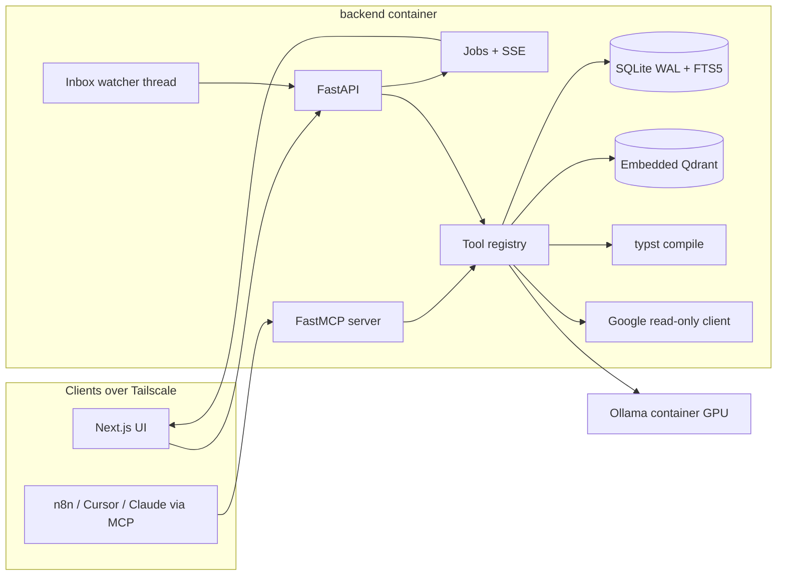

# Sparky_rATS

A private, self-hosted **Reverse ATS**: a candidate-side applicant intelligence platform that runs
entirely on one machine (the "Sparky" NVIDIA DGX Spark / GB10) and never sends anything outbound on
your behalf.

Corporate applicant tracking systems (Workday, Greenhouse, Taleo, SuccessFactors) filter candidates
down for recruiters. Sparky_rATS flips that: it ingests the job, compares it against what you have
actually done, tells you where you pass, where you can bridge, and where you genuinely fall short,
and then compiles an ATS-safe CV and cover letter (EN / SK) that you review and submit yourself.

> Status: **Slice 2 is implemented on this branch** (bundle upload, inbox ingest, chunking,
> FTS5 and embeddings, lexical plus cited traffic-light matching, skills profile, eval harness),
> stacked on Slice 1. It is not merged to `main` yet. Architecture decisions are recorded in
> [docs/ADR.md](docs/ADR.md). Slices 3–5 are not built yet.

### Run the skeleton

Python 3.12, from a virtualenv:

```bash
pip install -e "backend[dev]"
export SPARKY_DATA_DIR=/tmp/sparky_rats
export SPARKY_API_TOKEN=dev-token
export SPARKY_MCP_TOKEN=dev-mcp-token
uvicorn app.main:app --host 127.0.0.1 --port 8002
```

`GET /health` is open. Every other API route needs `Authorization: Bearer $SPARKY_API_TOKEN`,
or a `Tailscale-User-Login` header when the TCP peer is listed in
`SPARKY_TAILSCALE_PROXY_HOSTS`. The MCP placeholder listens on port 8001 and accepts only
`SPARKY_MCP_TOKEN`. If a token is unset, the backend generates one and writes it under
`$SPARKY_DATA_DIR/credentials/` (mode 0600).

```bash
export SPARKY_API_TOKEN=dev-token
export SPARKY_API_BASE=http://127.0.0.1:8002
cd frontend && npm install && npm run dev
```

The UI calls the API through the Next.js server, which adds the bearer token.
`GET /health` stays public. Ingest, bundle upload, evaluation, and skill proposals return a job.
`POST /salary/net` and profile edits are synchronous.

Bundles: `POST /bundles`, `POST /bundles/{id}/documents` (multipart), `POST /projects/{id}/evaluate`.
Text, Markdown, and HTML parse without extra packages. PDF and DOCX need
`pip install 'sparky-rats[parse]'` (Docling). Photos are transcribed by the vision role.
Dropping a file into `$SPARKY_DATA_DIR/inbox` moves it to `bundles/_inbox` and ingests it into
the Inbox bundle. A repeated file hash is skipped before any model call.

On the Spark, `docker compose up --build` publishes the API on host port 8002
(the container still listens on 8000; host port 8000 is left for Portainer), MCP on 8001, and the UI
on `SPARKY_BIND_HOST` (default `127.0.0.1`). It reserves the GPU for Ollama only. See `.env.example`.

---

## Table of contents

1. [What it does](#what-it-does)
2. [What it deliberately does not do](#what-it-deliberately-does-not-do)
3. [Target hardware](#target-hardware)
4. [Architecture overview](#architecture-overview)
5. [Technology stack](#technology-stack)
6. [Domain model](#domain-model)
7. [Core pipelines](#core-pipelines)
8. [Integration surface (MCP)](#integration-surface-mcp)
9. [Security model](#security-model)
10. [Repository layout](#repository-layout)
11. [Persistent data layout](#persistent-data-layout)
12. [Build roadmap](#build-roadmap)
13. [Design documents](#design-documents)

---

## What it does

Five operational loops:

1. **Target job ingestion.** A Profesia.sk URL, a seven-digit Profesia ID, an uploaded PDF, or a
   phone photo of a posting becomes a structured **Job Project**: title, company, contract type,
   salary bracket, requirements, offerings, dates, contacts.
2. **Knowledge bundling.** Your history lives in **Knowledge Bundles**: previous tailored CVs,
   cover letters, original postings, recruiter correspondence, screenshots. Bundles are the only
   source of truth about you; the system never invents experience.
3. **Local dual-layer matching.** A deterministic lexical pass emulates what a corporate ATS parser
   sees, then a local LLM performs a semantic gap analysis, producing a traffic-light report
   (green = evidenced, yellow = transferable, red = absent) with citations into your bundles.
4. **Sandboxed observation.** Read-only Gmail and Calendar access tracks recruiter communication per
   project. Drafted replies land in a clipboard staging area; you paste and send them yourself.
5. **Deterministic document generation.** Single-column, parser-safe CVs and cover letters are
   compiled with Typst from a structured JSON model and verified by a round-trip ATS check.

Plus a **Slovak gross-to-net calculator** that converts the legally mandated published base wage
into take-home pay and total employer cost using the current tax year's rules.

## What it deliberately does not do

- It does not send email, create calendar events, or touch Google Drive.
- It does not call any cloud LLM. All inference is local (Ollama on the GB10).
- It does not fabricate qualifications. Every green claim must cite a bundle chunk.
- It is not multi-tenant. One candidate, one machine, reachable only over Tailscale.

## Target hardware

| Component | Specification |
| --- | --- |
| Platform | NVIDIA DGX Spark, GB10 Grace Blackwell, aarch64 |
| CPU | 20-core Arm (10x Cortex-X925, 10x Cortex-A725) |
| GPU | Blackwell, CUDA 13 |
| Memory | 128 GB LPDDR5x unified, ~273 GB/s |
| Storage | 4 TB NVMe |
| OS | NVIDIA DGX OS (Ubuntu 24.04 LTS) |
| Network | LAN + Tailscale mesh |

The 273 GB/s bandwidth is the governing constraint. It favours mixture-of-experts models
(40–100 tok/s) over dense 70B-class models (~5 tok/s). See [ADR-002](docs/ADR.md#adr-002).

## Architecture overview



Three containers managed by Docker Compose: `ollama`, `backend`, `frontend`. All mutable state is on
the host at `/mnt/data/sparky_rats`, mounted as `/data`.

## Technology stack

| Concern | Choice | Notes |
| --- | --- | --- |
| Backend | FastAPI, Python 3.12 | REST + SSE; hosts tool registry and MCP server |
| Frontend | Next.js (standalone), React, Tailwind | Kanban, project view, bundle library, settings |
| Relational store | SQLite 3 (WAL) + FTS5 | Numbered SQL migrations |
| Vector store | Embedded Qdrant (single process) | `sqlite-vec` is the documented fallback |
| Inference | Ollama (ARM64, CUDA) | Role-based model config: `fast`, `heavy`, `vision`, `embed` |
| Embeddings | bge-m3 (dense, 1024-d) | Lexical coverage comes from FTS5, not sparse vectors |
| Scraping | httpx + Schema.org JSON-LD | Crawl4AI / Chromium as lazy fallback |
| Document parsing | Docling | Qwen-VL class vision model for image-only inputs |
| Document generation | Typst (native aarch64) | Templates read a JSON model via `sys.inputs` |
| Tool protocol | FastMCP (streamable HTTP) externally; Ollama native tool-calling internally | |
| Google | google-auth + httpx, read-only scopes | GET-only transport interceptor |

Model names are configuration, not code. Defaults are chosen by a benchmark script run on the
target machine (Slice 5).

## Domain model

| Table | Purpose |
| --- | --- |
| `projects` | One targeted position: source, company, title, contract, salary, dates, contacts, extracted requirements/offerings |
| `project_stages` | Ordered pipeline stages per project (CV draft, submitted, screening, rounds, offer); project status is derived from these |
| `knowledge_bundles` | Named clusters of candidate documents; `historical_baseline` or `active_application` |
| `bundle_documents` | Files in a bundle with extracted text and language |
| `document_chunks` | Heading-aware chunks of bundle documents; mirrored into FTS5 and Qdrant |
| `candidate_profile` | Singleton: identity, contact, languages, structured skills inventory |
| `match_evaluations` | Lexical report, traffic-light classification with citations, deterministic score, model and prompt version |
| `generated_documents` | Versioned CV / cover-letter artifacts: JSON model, Typst source, PDF path, round-trip ATS report, submitted flag |
| `project_chats` | Threaded, context-aware conversation per project with cited chunk ids |
| `jobs` | Async work items (ingest, evaluate, generate) with progress for SSE |
| `tax_params` | Per-tax-year Slovak payroll parameters |
| `system_credentials` | Fernet-encrypted OAuth material |

## Core pipelines

**Ingestion.** Input classifier (regex for Profesia ID / URL, MIME for files) → httpx GET + JSON-LD
`JobPosting` parse → Crawl4AI fallback on 403/503/empty → Docling for PDF/DOCX → vision model for
images → fast LLM structured extraction (Pydantic schema) → `projects` row + job completion event.

**Salary.** `salary_calc` takes gross monthly EUR and a tax year. 2026 rules: employee social 9.4%
(capped), employee health 5%, NČZD 497.23/month with high-income phase-out, four tax brackets
(19/25/30/35%), employer 36.2%. TPP only; other contract types are reported as not modeled.
Golden tests against official Finančná správa examples.

**Matching.** Requirement keyword extraction → EN/SK alias dictionary → word-boundary matching over
FTS5 (the "what the ATS sees" layer) → hybrid retrieval (dense + FTS5) → heavy LLM classifies each
requirement green/yellow/red with chunk citations (structured output) → citations verified against
the retrieved set → score computed deterministically from explicit weights.

**Generation.** Heavy LLM fills a `ResumeModel` / `CoverLetterModel` → fixed Typst template renders it
→ `typst compile --root <tmpdir>` → `pdftotext` → lexical matcher re-run on the actual PDF text →
`generated_documents` row. Submitting attaches the PDF to the project's `active_application` bundle.

## Integration surface (MCP)

Tools are defined once in `backend/tools/` and exposed two ways:

- **Internally**, the agent loop passes tool schemas to Ollama's native tool-calling API and executes
  returned calls. (Ollama does not consume MCP servers; this is the only way local models call tools.)
- **Externally**, FastMCP serves the same registry over streamable HTTP with bearer-token auth, bound
  to the Tailscale interface. n8n (MCP Client Tool node), Cursor, and Claude Desktop can drive
  Sparky: ingest a link from a Telegram message, run an evaluation nightly, pull the Google timeline
  for stale projects.
- **Optionally**, Sparky acts as an MCP client to registered external servers (for example an n8n
  MCP Server Trigger). Because external tools may have side effects, each tool must be whitelisted
  in settings before a local model can call it.

Initial tool set: `ingest_job`, `list_projects`, `get_project_details`, `query_knowledge_bundles`,
`evaluate_match`, `calc_net_salary`, `compile_tailored_pdf`, `fetch_google_timeline`.

## Security model

- **Network.** Services bind to the Tailscale interface only. Identity comes from `tailscale serve`
  headers, with a shared-secret fallback for non-Tailscale clients.
- **Google.** Scopes limited to `gmail.readonly` and `calendar.events.readonly`. The HTTP transport
  permits POST only to the OAuth token and revoke endpoints and rejects any non-GET to API hosts.
  The OAuth app is registered as Workspace-Internal. A "Revoke and wipe" action revokes and deletes
  tokens.
- **Outbound communication.** None. Drafts go to a clipboard staging buffer.
- **LLM-authored content.** Typst compiles inside a throwaway `--root`, so model output cannot read
  files from `/data`. All model JSON is schema-validated before use.
- **Secrets.** Fernet-encrypted blobs in SQLite; master key at `/data/credentials/master.key` (0600).
- **Backups.** Nightly `sqlite3 .backup` plus Qdrant snapshot to `/data/backups/`.

## Repository layout

Planned layout (created incrementally by the build slices):

```
.
├── README.md
├── docs/
│   ├── ADR.md                      # architecture decision records
│   └── runbook.md                  # operations (Slice 5)
├── docker-compose.yml
├── backend/
│   ├── Dockerfile
│   ├── pyproject.toml
│   ├── app/
│   │   ├── main.py                 # FastAPI entry, lifespan starts watcher + MCP
│   │   ├── config.py               # env, model roles, paths
│   │   ├── auth.py                 # Tailscale identity / shared secret
│   │   ├── secrets_store.py        # Fernet blobs, master.key bootstrap
│   │   ├── inbox_observer.py       # watchdog thread used by the inbox watcher
│   │   ├── docling_convert.py      # optional PDF/DOCX conversion (ADR-022)
│   │   ├── data/aliases_v1.json    # EN/SK alias dictionary
│   │   ├── db/                     # connection, migrations/*.sql, repositories
│   │   ├── vector_store.py         # embedded Qdrant wrapper (single instance)
│   │   ├── jobs.py                 # async job runner + SSE
│   │   ├── llm/                    # ollama_client.py, schemas/, prompts/
│   │   ├── tools/                  # tool registry (shared by agent loop and MCP)
│   │   ├── mcp_server.py           # FastMCP streamable-HTTP server
│   │   ├── mcp_client.py           # optional external MCP servers, whitelist
│   │   ├── services/
│   │   │   ├── scraper.py          # httpx JSON-LD + HTML parse, Crawl4AI fallback
│   │   │   ├── parser.py           # text/Markdown/HTML, Docling + vision, chunking
│   │   │   ├── bundle_ingest.py    # hash, chunks, FTS5, embeddings
│   │   │   ├── salary_calc.py      # year-parameterized Slovak payroll
│   │   │   ├── ats_engine.py       # lexical matcher, alias dictionary, scoring
│   │   │   ├── evaluator.py        # retrieval + LLM classification + citation check
│   │   │   ├── profile.py          # skills inventory proposal and confirm merge
│   │   │   ├── doc_generator.py    # JSON model -> Typst -> PDF -> round-trip check
│   │   │   ├── google_client.py    # read-only client with transport interceptor
│   │   │   └── watcher.py          # in-process inbox observer
│   │   └── templates/
│   │       ├── resume_en.typ
│   │       ├── resume_sk.typ
│   │       └── cover_letter.typ
│   ├── tests/                      # salary goldens, scraper fixtures, matching tests
│   └── evals/                      # posting + bundle cases, agreement by model/prompt
├── frontend/
│   ├── Dockerfile
│   └── src/app/, src/components/
└── scripts/
    ├── benchmark_models.sh         # pick default models on the Spark
    └── backup.sh
```

## Persistent data layout

```
/mnt/data/sparky_rats  (host)  ->  /data (containers)
├── sparky_rats.db          SQLite database (WAL)
├── qdrant/                 embedded Qdrant storage
├── ollama/                 model weights (OLLAMA_MODELS)
├── bundles/                uploaded bundle files, plus _inbox and _raw
├── inbox/                  hot folder watched for ingestion
├── exports/                compiled PDFs
├── credentials/            master.key (0600)
└── backups/                nightly snapshots
```

## Build roadmap

Vertical slices; each one leaves the system usable.

| Slice | Delivers |
| --- | --- |
| 0 | Repo skeleton, compose, FastAPI/Next.js scaffolds, schema + migrations, jobs + SSE, Ollama role client, auth |
| 1 | Profesia ingestion, structured extraction, 2026 salary engine with golden tests, project list/detail UI with gross-to-net panel |
| 2 | Bundle upload + inbox watcher, Docling/vision parsing, chunking, embeddings, FTS5, lexical + semantic evaluation, traffic-light UI, eval harness |
| 3 | Candidate profile, resume/cover-letter models, Typst templates, sandboxed compile, round-trip ATS check, versioned documents, PDF preview |
| 4 | Stages/Kanban, Google read-only client + interceptor tests, clipboard staging, tool registry, Ollama tool loop, FastMCP server, optional MCP client, project chat |
| 5 | Backups, model benchmark on the Spark, runbook |

## Design documents

- [docs/ADR.md](docs/ADR.md): numbered architecture decision records with context, decision,
  alternatives, and consequences. Decisions that supersede the original specification say so.
- Original specification: Sparky_rATS Master Architecture and Design Specification (v0.9 → v1.2),
  reviewed and revised in October 2026. The revision is captured in the ADRs; the original is kept
  for history rather than as a build reference.
