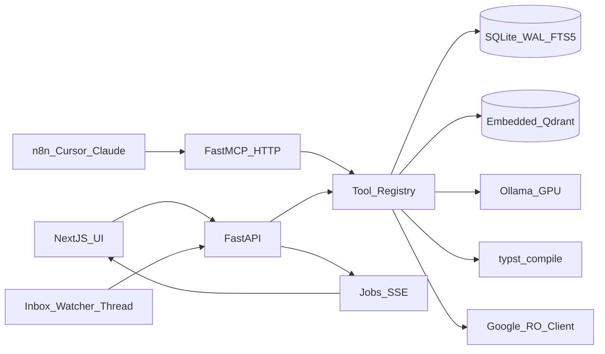

# Sparky_rATS Build Plan

Source of truth for this plan: [README.md](README.md) (outline, layouts, roadmap table) and
[docs/ADR.md](docs/ADR.md) (decisions). Where this plan and those documents disagree, the
documents win and this plan is corrected.

## Working agreement

- Branch per slice: `cursor/slice-N-<name>-851a` off `main`, PR into `main`, one logical commit per
change.
- Nothing from `/data` or any secret is ever committed; `.gitignore` is already in place and is
extended before any new artifact type is produced.
- Each slice ends with: tests green, the README repository layout updated if it changed, and any
new decision appended to `docs/ADR.md`.
- Model names only in config (ADR-002). Every LLM data call is structured output + Pydantic
(ADR-018). Every tool is defined once in `backend/app/tools/` (ADR-010).

## Target layout (from README)

```
backend/app/{main,config,auth,vector_store,jobs,mcp_server,mcp_client}.py
backend/app/db/{database.py,migrations/*.sql,repositories/}
backend/app/llm/{ollama_client.py,schemas/,prompts/}
backend/app/tools/
backend/app/services/{scraper,parser,salary_calc,ats_engine,evaluator,doc_generator,google_client,watcher}.py
backend/app/templates/{resume_en,resume_sk,cover_letter}.typ
backend/tests/ (+ fixtures/), backend/evals/
frontend/src/app/, frontend/src/components/
scripts/{benchmark_models.sh,backup.sh}
docker-compose.yml, docs/runbook.md
```




## Slice 0 – Skeleton (ADR-001, 003, 004, 005, 012, 013, 014, 018)

- `docker-compose.yml`: `ollama` (official ARM64 CUDA image, GPU reservation, `/data/ollama`,
env `OLLAMA_NUM_PARALLEL=1 OLLAMA_FLASH_ATTENTION=1 OLLAMA_KV_CACHE_TYPE=q8_0 OLLAMA_MAX_LOADED_MODELS=3`),
`backend`, `frontend`; bind mount `/mnt/data/sparky_rats:/data`; `restart: unless-stopped`.
- Backend: `pyproject.toml` (uv), FastAPI app with lifespan that opens the single DB pool and the
single Qdrant client, starts the watcher thread (stub) and the job runner.
- `db/database.py`: WAL, foreign keys, busy timeout; numbered migrations with `schema_version`.
`0001_init.sql` creates every table in the README domain model including `document_chunks` +
FTS5 virtual table, `jobs`, `tax_params`, `candidate_profile`, `generated_documents`,
`system_credentials`.
- `jobs.py`: QUEUED/RUNNING/DONE/FAILED/CANCELLED, per-type concurrency (LLM jobs serialized),
`GET /jobs/{id}/events` SSE, restart marks RUNNING as FAILED.
- `llm/ollama_client.py`: roles `fast|heavy|vision|embed` from config; `structured()` helper
that passes a Pydantic JSON schema as `format`, validates, retries once with the error.
- `auth.py`: trust `Tailscale-User-Login` only from the local Tailscale proxy; bearer secret
fallback; API and MCP on separate ports.
- `secrets_store.py`: Fernet; key from `SPARKY_MASTER_KEY` or `/data/credentials/master.key`
(0600, generated on first start).
- `.env.example`, `GET /health` (db, qdrant, ollama reachability, loaded models).
- Frontend: Next.js standalone scaffold, Tailwind, API client, layout shell.
- Tooling: pytest, ruff, mypy (strict on services), GitHub Actions running tests without network.

## Slice 1 – First usable loop (ADR-006, 007, 020)

- `services/scraper.py`: input classifier (Profesia ID / URL regexes from the spec, MIME for
files); httpx GET with browser headers and per-host rate limit; JSON-LD `JobPosting` parse;
HTML→Markdown body; raw HTML cached under `/data/bundles/_raw/`; Crawl4AI fallback on
403/503/challenge/missing JSON-LD with Chromium installed on first use.
- `llm/schemas/job_posting.py`: `JobPostingExtract` (salary normalization incl. "od X", hourly,
netto/brutto; contract type; mandatory/preferred requirements; offerings; language).
- `tax_params` seed for 2025 and 2026 (2026: employee social 9.4% capped at 16,764, health 5%,
NČZD 497.23 with phase-out 14,661.11 − base/3, brackets 19/25/30/35 at 3,665.28 / 5,029.10 /
6,250.86, employer 25.2% + 11%).
- `services/salary_calc.py`: Decimal, per-component rounding, full breakdown; TPP only,
`not_modeled` for SZČO/Dohoda. Golden tests incl. official example (base 6,000, no NČZD →
1,328.63) and a 2,000–7,000 IT range cross-checked at implementation time.
- REST: `POST /projects/ingest` (202 + job), `GET /projects`, `GET /projects/{id}`,
`POST /salary/net`.
- UI: ingestion input bar, project list, project detail with requirements/offerings and a
gross-to-net panel (NČZD toggle, tax year selector).
- Tests: scraper against `backend/tests/fixtures/*.html` (synthetic or anonymized), classifier
regex table, salary goldens.

## Slice 2 – Bundles and matching (ADR-004, 005, 006, 008, 016, 020)

- Bundle CRUD and upload; watcher: debounce, hash, move to `/data/bundles/_inbox/`, enqueue
`ingest_file`; duplicate detection by hash.
- `services/parser.py`: Docling with heading/reading order; vision-role fallback below a text
threshold; language detection; heading-aware ~400-token chunks → `document_chunks`, FTS5,
Qdrant payload (`bundle_id, project_id, document_id, chunk_index, doc_type, language, section_header, content_hash, token_count`).
- `services/ats_engine.py`: requirement keyword extraction schema (`term, category, mandatory`);
EN/SK alias dictionary as a versioned data file with tests; word-boundary matching over FTS5;
`lexical_report` with filter hazards.
- `services/evaluator.py`: hybrid retrieval (dense + FTS5, RRF, filtered by bundle ids);
heavy-role GREEN/YELLOW/RED classification with `chunk_id` citations; citation verification
(GREEN without valid citation → YELLOW + flag); deterministic score from stored weights
(0.6/0.3/0.1); persist `model_name`, `prompt_version`, `score_weights`.
- Candidate profile: fast-role proposal of skills inventory from bundles; confirm/edit UI;
confirmed inventory becomes an input to evaluation.
- UI: bundle library, evaluation runner with job progress, traffic-light view with citations.
- `backend/evals/`: cases (posting + bundles + expected colours), runner reporting agreement per
model/prompt version.

## Slice 3 – Generation (ADR-009, 015, 018)

- `llm/schemas/documents.py`: `ResumeModel`, `CoverLetterModel`.
- Prompts: `tailor_resume_v1`, `cover_letter_v1` with Slovak terminology rules (technical terms
stay English, legal employment terms Slovak, formal vykanie), `PROMPT_VERSION` stored.
- Templates `resume_en.typ`, `resume_sk.typ`, `cover_letter.typ`: single column, standard
margins, Liberation Sans/Roboto, data via `sys.inputs`, no tables/frames/graphics.
- `services/doc_generator.py`: write JSON, `typst compile --root <tmpdir> --font-path`, PDF to
content-addressed path under `/data/exports/`, `pdftotext`, re-run lexical matcher →
`ats_roundtrip_report`; raw-markup advanced path under the same sandbox.
- `generated_documents` versioning; diff view at `content_json` level; mark-as-submitted copies
into the project's `active_application` bundle.
- UI: generate CV / cover letter (EN/SK), PDF preview, round-trip report, version history.

## Slice 4 – Timeline, Google, tools and MCP (ADR-010, 011, 013, 017)

- `project_stages` CRUD; `current_status` recomputed by service on stage change; statuses incl.
WITHDRAWN/GHOSTED/ON_HOLD; Kanban moves stages.
- `services/google_client.py`: OAuth flow for a Workspace-Internal client with scopes
`gmail.readonly`, `calendar.events.readonly`; httpx transport hook (POST allowed only to
`oauth2.googleapis.com/token|revoke`, GET-only to `*.googleapis.com`, else `ReadOnlyViolation`)
with a unit test per branch; per-project timeline by company domain/contacts and lookback;
optional attach as `EMAIL_THREAD`; clipboard staging buffer; revoke-and-wipe; token age shown.
- `tools/`: `ingest_job, list_projects, get_project_details, query_knowledge_bundles, evaluate_match, calc_net_salary, compile_tailored_pdf, fetch_google_timeline`, each with Pydantic
params/results and a `side_effects` flag.
- Project chat: Ollama native tool-calling loop over the registry; `project_chats` with
`thread_id` and `referenced_chunks`.
- `mcp_server.py`: FastMCP streamable HTTP on its own port, bearer auth, Tailscale-bound; smoke
test with an MCP client; n8n MCP Client Tool node documented in the runbook.
- `mcp_client.py` (optional): register external MCP servers; discovered tools disabled by default;
per-tool whitelist in settings before the agent loop may call them.

## Slice 5 – Hardening (ADR-002, 012, 019, 020)

- `scripts/benchmark_models.sh`: pull candidates, measure decode tok/s and TTFT at 8k/32k on the
Spark, write results to `docs/benchmarks.md`; set role defaults in config accordingly.
- `scripts/backup.sh`: nightly `sqlite3 .backup`, Qdrant snapshot, rotation under
`/data/backups/`; runbook states that `master.key` must be backed up separately.
- `docs/runbook.md`: first start, tailnet ACLs, Google OAuth app setup, n8n MCP connection,
restore procedure, model swap procedure.
- Flip ADR statuses from Proposed to Accepted, recording benchmark and eval results in the log.

